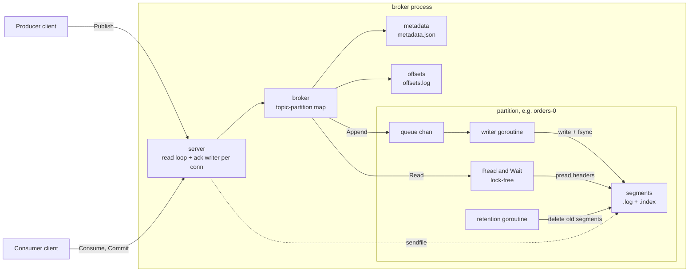
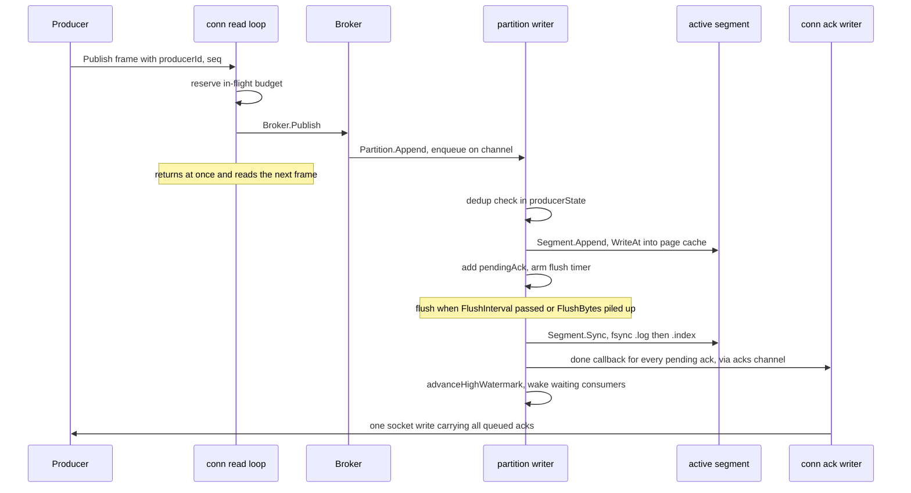
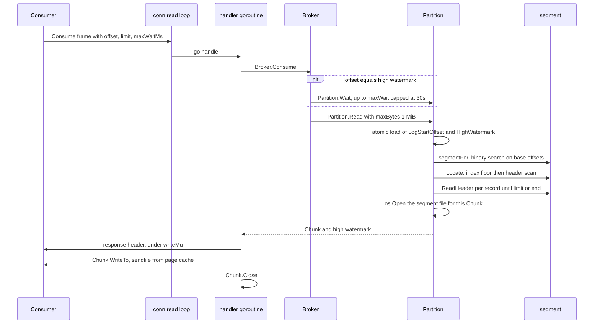

# Architecture

**What this covers:** the big picture. Which package does what, how a publish
and a consume travel through the broker, which goroutine owns which state, and
what ends up on disk. Storage details are in [storage.md](storage.md); fsync,
acks and crash recovery are in [durability-and-recovery.md](durability-and-recovery.md).

---

## Package map

Dependencies point downwards: `server` → `broker` → `partition` → `segment` → `record`.

| Package | Responsibility | Key files |
|---|---|---|
| [`internal/record`](../internal/record) | Byte format of one message: 40-byte header + body, CRC32-C. Used on disk **and** on the wire | [record.go](../internal/record/record.go) |
| [`internal/segment`](../internal/segment) | One `.log` file + its sparse `.index`: append, locate an offset, validate/repair a tail | [segment.go](../internal/segment/segment.go), [index.go](../internal/segment/index.go) |
| [`internal/partition`](../internal/partition) | One partition log: single writer, group commit, dedup, high watermark, zero-copy reads, recovery, retention | [writer.go](../internal/partition/writer.go), [reader.go](../internal/partition/reader.go), [recovery.go](../internal/partition/recovery.go), [retention.go](../internal/partition/retention.go) |
| [`internal/fsutil`](../internal/fsutil) | Durability helpers: `SyncDir`, `MkdirAll`, `WriteFileAtomic` | [fsutil.go](../internal/fsutil/fsutil.go) |
| [`internal/metadata`](../internal/metadata) | Topics, partitions, producer ids in one JSON file | [filestore.go](../internal/metadata/filestore.go) |
| [`internal/offsets`](../internal/offsets) | Committed consumer-group offsets: append-only log + in-memory map | [offsets.go](../internal/offsets/offsets.go) |
| [`internal/broker`](../internal/broker) | Glue: `(topic, partition)` → open `*partition.Partition`, long-poll, commits. No sockets | [broker.go](../internal/broker/broker.go) |
| [`internal/protocol`](../internal/protocol) | Binary wire format: frames, correlation ids, request/response bodies | [frame.go](../internal/protocol/frame.go), [messages.go](../internal/protocol/messages.go) |
| [`internal/server`](../internal/server) | TCP: per-connection read loop, ack writer, in-flight budget, sendfile consume path | [conn.go](../internal/server/conn.go), [consume.go](../internal/server/consume.go) |

## Components



## Life of a publish

Default ack mode (`AckAfterFsync`). Steps match `DESIGN.md` "Publish flow".



Key points:

- **Order is preserved end to end.** The read loop hands Publish to the broker
  inline ([`conn.readRequests`](../internal/server/conn.go)), `Partition.Append`
  enqueues in call order, and one writer drains the queue.
- **Acks happen before the watermark moves.** In [`writer.flush`](../internal/partition/writer.go)
  `ackPending()` runs before `advanceHighWatermark`, so a consumer never sees a
  record its producer has not been told is safe.
- **The writer never blocks on a socket.** Its `done` callback only pushes onto
  `conn.acks`, a channel sized to the per-connection in-flight cap (256), so it
  always has room.
- **Duplicates write nothing.** A retry with an already-seen sequence is re-acked
  with the original offset (see [durability-and-recovery.md](durability-and-recovery.md#idempotent-producer-state)).

## Life of a consume



Key points:

- Consume runs in its own goroutine because it may long-poll; the read loop keeps
  serving other requests on the connection meanwhile.
- `Partition.Read` takes no lock on data. It reads the atomic high watermark and
  never returns bytes past it ([reader.go](../internal/partition/reader.go)).
- The broker reads **headers only**, to find byte boundaries. Bodies go from page
  cache to socket without entering user space. Details in [storage.md](storage.md#the-read-path).

## Goroutines and ownership

### Who runs

| Goroutine | How many | Started in | Does |
|---|---|---|---|
| Accept loop | 1 per listener | [`Server.Serve`](../internal/server/server.go) | Accepts, enforces `MaxConns` (default 1024) |
| Connection read loop | 1 per conn | [`conn.serve`](../internal/server/conn.go) | Reads frames, enqueues Publish inline, spawns handlers |
| Ack writer | 1 per conn | [`conn.writeAcks`](../internal/server/conn.go) | Batches queued publish acks into one write |
| Request handler | 1 per non-Publish request | `conn.handle` | Consume (may long-poll), Commit, Metadata, ... |
| Partition writer | 1 per partition | [`Partition.Open`](../internal/partition/partition.go) → `runWriter` | All writes, fsyncs, acks, segment rolls, checkpoints |
| Retention | 1 per partition | `Partition.Open` → `runRetention` | Every `RetentionCheck` (default 1m), deletes expired segments |

### Who owns what

| State | Owner / guard | Readers |
|---|---|---|
| Active segment file, `nextOffset`, `producerState`, pending acks, flush timer | Writer goroutine only, no lock | — |
| `highWatermark`, `logStartOffset` | `atomic.Int64`; writer and retention store | Any reader, lock-free |
| `hwChanged` (wake-up channel) | `atomic.Pointer`; closed and replaced on every watermark move | `Partition.Wait` |
| `segments` slice | `segMu` RWMutex: writer appends on roll, retention detaches from the front | Readers `RLock` only to pick a segment, never during I/O |
| Sparse index entries | `index.mu` RWMutex: writer appends | `index.floor` under `RLock` |
| Segment `size`, `lastTimestamp` | Atomics, written by the writer | Readers, retention |
| Partition map | `Broker.mu` RWMutex; `createMu` serializes topic creation | Every request |
| Socket writes | `conn.writeMu`, so frames never interleave | — |

**Why a single writer?** Ordering and offset assignment come for free, the
dedup table needs no lock, and only one goroutine ever holds the file for
writing, so a segment roll needs no handoff. Partitions write in parallel with
each other.

**Why lock-free readers are safe:** the writer finishes writing a record before
it moves the watermark past it, and readers never go past the watermark. Reads
use `pread` (`ReadAt`), so readers never share a file offset with the writer.

**Backpressure:** if a partition's queue (`QueueSize`, default 4096) is full,
`Append` blocks, which blocks that connection's read loop, which lets TCP flow
control push back on the client. Each connection also caps unanswered requests
at 256 and `MaxInFlightBytes` (default 64 MiB) ([budget.go](../internal/server/budget.go)).

## On-disk layout

Rooted at the broker's `-data` directory (default `./data`), as set up in
[`broker.Open`](../internal/broker/broker.go):

```text
data/
├── metadata.json                     topics, partitions, next producer id
├── __consumer_offsets/
│   └── offsets.log                   committed offset per (group, topic, partition)
└── logs/
    └── orders-0/                     one dir per partition: <topic>-<partition>
        ├── 00000000000000000000.log    records, base offset 0
        ├── 00000000000000000000.index  sparse index for that segment
        ├── 00000000000000052113.log    next segment, first offset 52113
        ├── 00000000000000052113.index
        └── recovery.checkpoint         JSON: durable point + producer table
```

- Segment names are the base offset, zero-padded to 20 digits, so `ls` sorts
  them in offset order.
- The last segment is the **active** one; all earlier ones are closed and fully fsynced.
- `metadata.json` and `recovery.checkpoint` are replaced atomically
  (`<name>.tmp` → fsync → rename → fsync dir). `offsets.log` is compacted the same way.

## Limitations of this design

- **Single broker.** No replication; durability is one machine's disk. The README's
  "Next" section covers leader/follower replication.
- **Every partition opens all its segments at startup** and loads every `.index`
  fully into memory (see [storage.md](storage.md#limitations)).
- **One writer goroutine per partition** caps one partition's write throughput at
  what one goroutine plus one fsync stream can do. Scale-out is more partitions.

## Where to look in the code

- [internal/server/conn.go](../internal/server/conn.go) — `readRequests`, `publish`, `writeAcks`, `handle`
- [internal/server/consume.go](../internal/server/consume.go) — `consume`, `sendChunk`
- [internal/broker/broker.go](../internal/broker/broker.go) — `Open`, `Publish`, `Consume`, `waitForData`, `openTopic`
- [internal/partition/partition.go](../internal/partition/partition.go) — `Partition` struct, `Open`, `Append`, `Close`
- [internal/partition/writer.go](../internal/partition/writer.go) — `run`, `handle`, `write`, `flush`
- [internal/partition/reader.go](../internal/partition/reader.go) — `Read`, `Wait`, `advanceHighWatermark`
- [internal/server/budget.go](../internal/server/budget.go) — per-connection in-flight cap
