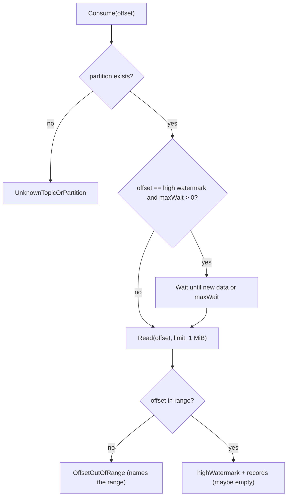

# Consumers, committed offsets and topic metadata

What this covers: how reading works (the Consume API, long-poll, the two client types), how a
consumer group's progress is stored durably in the committed-offsets log, what to do when
retention deletes your position, and the small metadata store for topics and producer ids.

---

## 1. The Consume API

```text
Consume(topic, partition, offset, limit, maxWaitMs) → (highWatermark, records)
```

The consumer says **where** to read. The broker keeps no per-consumer state for reads.
[`Broker.Consume`](../internal/broker/broker.go) does:

1. Look up the partition. Unknown → `UnknownTopicOrPartition`. **Consume never auto-creates a
   topic**, even with `-auto-create`, so a typo has no side effects.
2. **Long-poll:** only if `offset == highWatermark` (you're caught up) and `maxWait > 0`, wait in
   `Partition.Wait` until a record arrives or `maxWait` passes. The server clamps `maxWaitMs` to
   0..30 s. Timing out is the normal "nothing new" case: an empty answer, not an error.
3. `Partition.Read(offset, limit, 1 MiB)`:
   - never past the high watermark, so consumers never see unacked data;
   - at most `limit` records (`limit < 1` counts as 1), about 1 MiB, but **always at least one
     record** if one is available, even a bigger one;
   - never spans two segments. A response can be short even though more data exists, so loop.
4. `offset < LogStartOffset` or `offset > highWatermark` → `OffsetOutOfRange`, with the valid
   range in the message, e.g. `(log has offsets 120 to 450)`.
5. The records go out zero-copy (header + `sendfile`, see [protocol.md](protocol.md#7-the-consume-response-header-then-sendfile)).



## 2. Consumer vs GroupConsumer

Both live in [client/consumer.go](../client/consumer.go). Both reconnect on the next call if the
connection broke.

| | `Consumer` | `GroupConsumer` |
|---|---|---|
| Made by | `NewConsumer(ctx, addr)` | `consumer.Group(ctx, group, topic, partition)` |
| Scope | any topic/partition, any offset | one group on one partition |
| Position | you pass `offset` every call | tracked for you (`Position()`) |
| Start | wherever you say | the group's committed offset, **0 if it never committed** |
| Read | `Consume(ctx, topic, part, offset, limit, maxWait)` → records, hw | `Poll(ctx)` → records; moves position to last offset + 1 |
| Commit | `Commit(ctx, group, topic, part, offset)` | `Commit(ctx)` commits the current position |
| Defaults | n/a | `Limit = 100`, `MaxWait = 1s` |

Conventions:

- **A committed offset is the next offset to read**, not the last one processed.
- `GroupConsumer` gives **at-least-once** processing: if you crash after `Poll` but before
  `Commit`, the restarted consumer re-reads those records. Commit after processing.
- `Consumer.Consume`'s ctx must outlive `maxWait`, or the call gives up before the broker answers.
- "Consumer group" is just a name today: no membership, no partition assignment, no rebalancing.

Typical loop:

```go
c, _ := client.NewConsumer(ctx, "localhost:9092")
g, _ := c.Group(ctx, "billing", "orders", 0)
for {
    recs, err := g.Poll(ctx)
    if err != nil { /* see §3 */ }
    for _, r := range recs { process(r) }
    if len(recs) > 0 { g.Commit(ctx) }
}
```

## 3. When retention deletes your position: OffsetOutOfRange

Retention deletes whole segments (age 7 days or size 1 TiB by default). A slow group can come back
to a committed offset that's no longer on disk.

1. `Poll` returns `ErrOffsetOutOfRange`; the message names the offsets still on disk.
2. It **keeps failing** until you move: `g.SetPosition(newOffset)`. Nothing is skipped silently.
3. `SetPosition` isn't durable until you `Commit`.

There's no API that returns the log start offset by itself; today the only place it appears is
that error message (built in `Broker.Consume`).

Tests: `TestErrors` (offset past the high watermark) and the partition retention tests
(`TestRetentionByAge`, `TestReadRacingRetention`) cover `OffsetOutOfRange`. There's no end-to-end
test yet of `Poll` failing after retention and recovering via `SetPosition`.

## 4. Committed offsets store

[internal/offsets](../internal/offsets/offsets.go). File: `<data>/__consumer_offsets/offsets.log`.

### Shape

- **Append-only log** of commits, one entry per `Commit`.
- **In-memory map** `map[Key]int64` with `Key{Group, Topic, Partition}`, the latest offset per
  key. Reads (`Get`) never touch disk.
- **One mutex** serializes everything, including the fsync. Deliberate: commits are far rarer
  than publishes (once per batch, not per message), so a lock beats a group-commit pipeline.

### Entry format ([entry.go](../internal/offsets/entry.go))

```text
uint32 length      payload size
uint32 crc         CRC32-C of the payload
payload:
  uint16 len + group bytes
  uint16 len + topic bytes
  int32  partition
  int64  offset
```

### Commit, step by step ([`Store.Commit`](../internal/offsets/offsets.go))

1. Reject group/topic longer than 65535 bytes (`ErrNameTooLong` → `InvalidRequest` on the wire).
   The broker first checks the partition exists; the offset value itself isn't validated.
2. If the store is closed or **failed**, return that error.
3. `append`: write the entry, **fsync**. Only then update the map. The commit is durable when
   `Commit` returns.
4. If compaction is due, compact (below). A compaction failure **does not fail the commit**.

### Compaction

The log only grows, so it's rewritten with one entry per key once it's mostly stale.

| | |
|---|---|
| Trigger | `size > CompactAfterBytes` (64 MiB) **and** `size > 2 × liveBytes` **and** `size >= retryCompactionAt` |
| `liveBytes` | the size the log would have after compaction, kept up to date in `apply` |
| How | write live entries to `offsets.log.tmp` (opened for append), fsync, rename over `offsets.log`, fsync the directory. The tmp handle becomes the append handle, so no reopen step can fail after the swap |
| Back-off | on failure, log a warning and set `retryCompactionAt = 2 × size`: retry once the log has doubled, not on every commit |

### Torn tail on startup

`Open` replays the log into the map ([`replay`](../internal/offsets/offsets.go)) and stops at the
first entry that's bad: a partial header, a length above the max possible payload, a short
payload, a CRC mismatch, or a payload that doesn't parse. Everything from there on is truncated
and the file fsynced, the same idea as partition recovery. Note it stops at the **first** bad entry
wherever it is. Unlike the partition log, there's no "corrupt in the middle → refuse to start" case.

### Failed state

Some failures mean the file may no longer match what was acknowledged. The store then sets
`failed`, and `Commit` and `Compact` return that error **until the store is reopened** (which runs
recovery). `Get` keeps working.

| Failure | Why it's fatal |
|---|---|
| an append failed **and** cutting the file back to its old size also failed | a partial entry would sit in front of later commits, and recovery would truncate them away |
| the directory fsync after a compaction rename failed | after a crash the old log could come back, without the commits appended since |

A plain append failure that *could* be cut back just fails that one commit. On the wire a failed
store shows up as `Unknown`; a closed one as `ShuttingDown`.

## 5. Topic metadata store

[internal/metadata](../internal/metadata/filestore.go). File: `<data>/metadata.json`.

```json
{
  "topics": { "orders": { "ID": 1, "Name": "orders", "Partitions": [
      { "ID": 1, "TopicID": 1, "Number": 0, "LeaderID": 1 } ] } },
  "nextTopicId": 2,
  "nextPartitionId": 2,
  "nextProducerId": 1
}
```

- Small and rarely changed, so **the whole state lives in memory** and the **whole file is
  rewritten on every change**.
- **Atomic write:** each mutation builds the *next* state, writes it with
  `fsutil.WriteFileAtomic` (tmp + fsync + rename + fsync dir), and only then swaps it in. A failed
  write leaves memory and disk at the old state.
- `Store` is an interface; `FileStore` is the single-broker version. Multi-broker would back it
  with consensus.

### Topic rules ([metadata.go](../internal/metadata/metadata.go))

| Rule | Error (wire code) |
|---|---|
| name: `[a-zA-Z0-9._-]`, 1..200 chars, not starting with `__` (reserved, e.g. `__consumer_offsets`) | `InvalidTopic` |
| partitions: 1..`MaxPartitions` (1024) | `InvalidRequest` |
| name equal to an existing one **ignoring case** (`strings.EqualFold`) | `TopicExists` |

Why case-insensitive: partition directories are named `<topic>-<n>`, and on a case-insensitive
filesystem (macOS default) `Orders-0` and `orders-0` would be the same directory. Lookups are
still **exact**: if `orders` exists, publishing to `Orders` gets `UnknownTopicOrPartition`, even
with auto-create.

Other facts:

- Topic, partition and producer ids come from global counters starting at 1, never reused.
- `Topics()` returns topics in creation order.
- Every new partition's `LeaderID` is this broker's `-id`. It's carried everywhere so multi-broker is additive.
- Auto-create (`-auto-create`, off by default) happens only on **publish**, with 1 partition.

### Producer id allocation

`NextProducerID` takes the counter, **persists the incremented state before returning**, then
hands out the id. Ids therefore increase across restarts and a crash can't hand the same id out
twice, which is what dedup relies on (see [exactly-once.md](exactly-once.md)). Each call is a full
file rewrite + fsync, which is fine: a producer stream calls it once at start and again only after
a real failure.

---

## Where to look in the code

- [internal/broker/broker.go](../internal/broker/broker.go): `Consume`, `waitForData`, `Commit`, `CommittedOffset`, `partition` (auto-create)
- [internal/partition/reader.go](../internal/partition/reader.go): `Read`, `readChunk`, `Wait`
- [client/consumer.go](../client/consumer.go): `Consumer`, `GroupConsumer`, `Poll`, `SetPosition`
- [internal/offsets/offsets.go](../internal/offsets/offsets.go): `Open`, `recover`, `replay`, `Commit`, `append`, `needsCompaction`, `compactLocked`
- [internal/offsets/entry.go](../internal/offsets/entry.go): `appendEntry`, `readEntry`
- [internal/metadata/metadata.go](../internal/metadata/metadata.go): `ValidateTopicName`, `MaxPartitions`
- [internal/metadata/filestore.go](../internal/metadata/filestore.go): `CreateTopic`, `NextProducerID`, `save`
- Tests: [offsets_test.go](../internal/offsets/offsets_test.go), [filestore_test.go](../internal/metadata/filestore_test.go), [broker_test.go](../internal/broker/broker_test.go), `TestGroupConsumerResumes` / `TestLongPoll` in [server_test.go](../internal/server/server_test.go)
