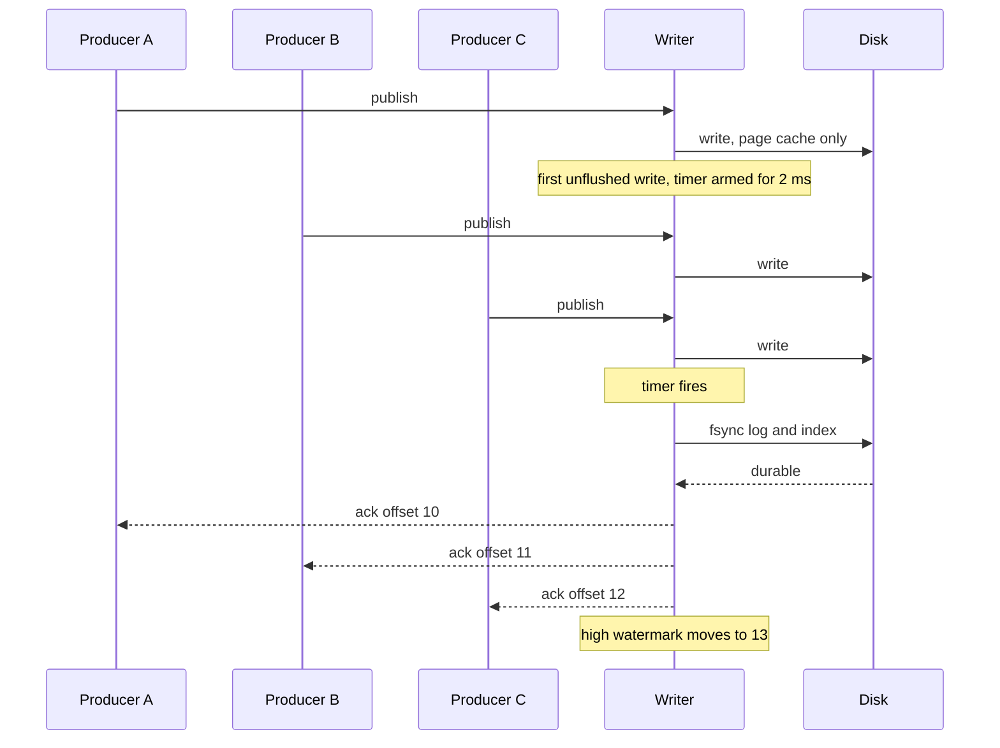
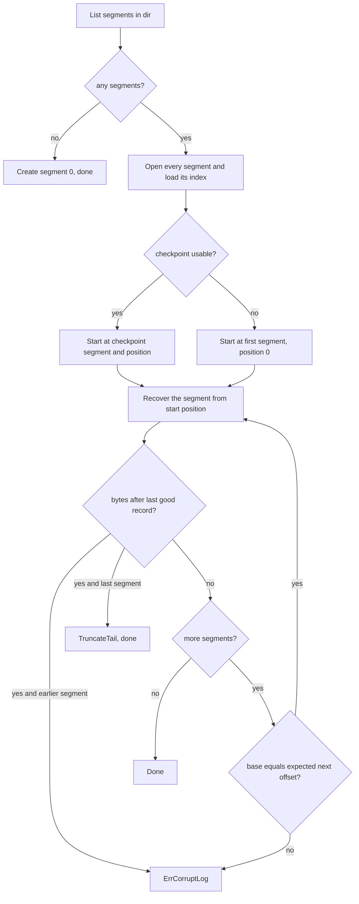

# Durability and Recovery

**What this covers:** what happens inside the partition writer, when a publish
is acked, when data becomes readable, and how a partition repairs itself after
a crash. Ends with a table of what survives which kind of crash. Byte formats
are in [storage.md](storage.md); the overall flow is in [architecture.md](architecture.md).

---

## The write path

Everything below runs on **one goroutine per partition**, the writer
([writer.go](../internal/partition/writer.go)). It takes requests off the queue
one at a time in [`writer.run`](../internal/partition/writer.go) and handles each in `handle` → `write`:

1. **Offline?** If an earlier I/O error took the partition offline, fail with that error.
2. **Too big?** Body over 1 MiB → `ErrMessageTooLarge`.
3. **Dedup** (skipped for `NoProducerID`): `producers.check(pid, seq)` returns new,
   duplicate, or `ErrOutOfOrderSeq`. A duplicate is re-acked and nothing is written.
4. **Build the record** with `Offset = nextOffset` and `Timestamp = Now()`.
5. **Roll** the segment first if the record would not fit (see [storage.md](storage.md#rolling)).
6. **Append** to the active segment with `WriteAt`. The bytes are now in the OS
   page cache, **not** on disk.
7. **Remember** `(seq → offset)` in the producer table and bump `nextOffset`.
8. **Arm the flush timer** if this is the first unflushed write, and add the record's
   size to `unflushedBytes`.
9. **Ack or park.** `AckBeforeFsync`: ack now and move the high watermark.
   `AckAfterFsync`: add to `pending`.
10. **Flush early** if `unflushedBytes >= FlushBytes`.

## Group commit

An fsync typically costs milliseconds. Doing one per message would cap a partition
at one message per fsync and make every producer wait in line behind the others. Instead the
writer **writes each record immediately but fsyncs once per batch**.

| Setting | Default | Meaning |
|---|---|---|
| `FlushInterval` | 2 ms | Linger: flush this long after the **first** unflushed write |
| `FlushBytes` | 1 MiB | Flush early once this many bytes are unflushed |



[`writer.flush`](../internal/partition/writer.go) does, in order:

1. Stop the timer. Nothing unflushed (or offline) → return.
2. `active.Sync()`: fsync the `.log`, then the `.index`. On error → offline.
3. Reset `unflushedBytes`.
4. `AckAfterFsync`: `ackPending()`, **then** `advanceHighWatermark(nextOffset)`.
5. If `CheckpointInterval` (1 s) has passed since the last one, write a checkpoint.

**Why this keeps p99 low.** A publish waits roughly one linger (2 ms) plus one
fsync (or two, if it arrives while the previous batch is syncing), however many
others share it. The fsync blocks the writer, and while
it runs new requests pile up in the queue and become the next batch, so batches
grow by themselves under load and one fsync acks many producers. The server's
ack writer then sends all queued acks for a connection in one socket write
([`conn.writeAcks`](../internal/server/conn.go)).

The README's bench run (Docker on a laptop, `-ack fsync`, 128 publishers) shows
the effect: p99 around 12 ms with every ack waiting for an fsync.

## Ack modes

Set with `-ack fsync|async` on the broker ([main.go](../cmd/broker/main.go)).

| | `AckAfterFsync` (`fsync`, default) | `AckBeforeFsync` (`async`) |
|---|---|---|
| Producer acked | After the batch's fsync | Right after `WriteAt` |
| Readable by consumers | After the fsync | Right after `WriteAt` |
| fsync | Group commit timer / bytes | Same timer / bytes, still runs |
| Duplicate re-ack | Waits for the same fsync if anything is unflushed (the original may be in it) | Immediate |
| Latency | ~linger + fsync | ~queue + write |
| Process crash | No acked loss | No acked loss (page cache survives) |
| Power loss | No acked loss | Up to one unflushed batch of **acked** data lost |
| Analogy | — | Kafka's default; relies on replication, which this broker does not have |

`AckBeforeFsync` has a subtler cost: consumers may read records that a power loss
then erases, and the recovered log will hand those offsets to new records.

## When the high watermark moves

`highWatermark` is the next offset readers may see (exclusive), an `atomic.Int64`
in [partition.go](../internal/partition/partition.go).

| Moment | New value | Code |
|---|---|---|
| `Partition.Open`, after recovery | `active.NextOffset()`: every recovered record is readable | `Open` |
| `AckAfterFsync`: end of each successful flush, after acks | `nextOffset` | `writer.flush` |
| `AckBeforeFsync`: after each write, after its ack | `nextOffset` | `writer.write` |

Each move in a running partition calls `notifyWaiters`, which closes the current `hwChanged` channel and
swaps in a new one: one close wakes every long-polling `Wait` at once.

## Idempotent producer state

The dedup table lives in [producerstate.go](../internal/partition/producerstate.go):
`producerState` maps producer id → its last **5** `(Seq, Offset)` pairs. Only the
writer touches it.

| Incoming `seq` | Result |
|---|---|
| `< 0` | `ErrOutOfOrderSeq` |
| `last + 1` (or `0` for an unknown producer) | New: write it |
| `≤ last`, inside the window | Duplicate, re-ack with the **original** offset |
| `≤ last`, older than the window | Duplicate, re-ack with offset `-1` |
| `> last + 1` | Gap: `ErrOutOfOrderSeq` |

It is saved in every checkpoint and rebuilt after a crash by replaying record
headers (below). Before each checkpoint, `expire(LogStartOffset)` drops producers
whose newest record retention has deleted; such a producer must start again at 0.

## Going offline on I/O errors

Any write, fsync, roll or checkpoint error calls
[`writer.takeOffline`](../internal/partition/writer.go): every pending request
fails with that error, and so does every later one, until the partition is
reopened (which runs recovery). After a failed fsync the kernel may already have
dropped the dirty pages, so a retry that "succeeds" proves nothing. Recovery from
disk is the only trustworthy answer.

## The recovery checkpoint

A per-partition JSON file, `recovery.checkpoint`
([checkpoint.go](../internal/partition/checkpoint.go)). It says "everything before
this point is fsynced", so recovery only scans what comes after.

```json
{"SegmentBase":0,"Position":248976,"NextOffset":234,
 "Producers":{"7":[{"Seq":40,"Offset":229},{"Seq":41,"Offset":233}]}}
```

| Field | Meaning |
|---|---|
| `SegmentBase` | Base offset of the active segment at the time |
| `Position` | Byte size of that segment: a durable record boundary |
| `NextOffset` | Offset the next record gets |
| `Producers` | The producer table as of that point |

**When it is written.** Always by the writer, always right after a flush, so
nothing is unflushed and `Position` is truly durable:

- after a flush, if `CheckpointInterval` (default 1 s) has passed since the last one;
- on segment roll (pointing at the new segment, position 0);
- on `Close`, after the final flush.

**How.** [`fsutil.WriteFileAtomic`](../internal/fsutil/fsutil.go): write
`recovery.checkpoint.tmp`, fsync it, rename over the real file, fsync the directory.
A crash leaves the old checkpoint or the new one, never a mix. A checkpoint that
fails to parse anyway is logged and treated as missing, which means a full scan.

## Crash recovery, step by step

[`recoverLog`](../internal/partition/recovery.go) runs inside `Partition.Open`,
before the writer starts.



1. **List.** `segment.List` finds `*.log` files with 20-digit names, sorted. None →
   create segment 0 and stop.
2. **Open all segments.** `segment.Open` loads each `.index` (dropping any torn tail
   of entries) and reads headers after the last index entry to learn `NextOffset`
   and `LastTimestamp`. Segments before the checkpoint are **trusted**, not CRC-checked.
3. **Read the checkpoint.** It is usable if its segment exists and
   `Position <= segment size`. Otherwise start from the first segment, position 0,
   with an empty producer table.
4. **Validate the tail.** For each segment from the start point,
   [`Segment.Recover`](../internal/segment/segment.go):
   - drops index entries at or after the start position;
   - reads records forward with `scanFrom`, accepting each one only if the header
     is complete, `Length ≤ 1 MiB`, the body is complete, the CRC matches, **and**
     the offset is exactly the next expected one;
   - re-adds sparse index entries and replays each header into the producer table;
   - fsyncs the `.log` and `.index`;
   - reports `torn = true` if any bytes remain after the last good record.
5. **Truncate rules** ([`repairTail`](../internal/partition/recovery.go)):

| Situation | Action |
|---|---|
| Torn bytes in the **last** segment | `TruncateTail`: cut the file at the last good record, fsync |
| Torn bytes in an **earlier** segment | Fail `Open` with `ErrCorruptLog` |
| Next segment's base ≠ expected next offset | Fail `Open` with `ErrCorruptLog` |
| I/O error while reading | Fail `Open` with that error |

6. **Start serving.** `Open` sets the high watermark to the active segment's
   `NextOffset` and `LogStartOffset` to the first segment's base, then starts the writer.

### Why only the last segment may be truncated

[`writer.roll`](../internal/partition/writer.go) fsyncs a segment in full **before**
creating its successor. So a crash can only ever tear the last segment. A bad
record in an earlier one is not a torn write: it is disk corruption or tampering.
Truncating there would also have to throw away every later segment, since offsets
must be contiguous, deleting acked data. Failing loudly and leaving it to an
operator is the safer choice.

### Producer state rebuild

The rebuild starts from the checkpoint's `Producers` snapshot (or empty), and
`Recover` calls `producers.record(pid, seq, offset)` for every valid header
it scans. Because the CRC covers `ProducerID` and `Sequence`, those values can be
trusted. Result: a producer that retries after the crash gets `Duplicate` with
its original offset instead of a second copy.

This also covers a subtle case. After a **process** crash, records that were
written but never acked are still in the page cache. Recovery keeps them if valid,
and the producer's retry is caught as a duplicate.

## Directory fsyncs

fsync on a file makes its **contents** durable. Its **name** (create, rename,
delete) lives in the directory and is only durable after fsync on the directory
([fsutil.go](../internal/fsutil/fsutil.go)). Without it, a power loss can leave
a fully fsynced segment with no name pointing at it.

| Where | Directory synced | Protects |
|---|---|---|
| `segment.Create` | partition dir | New `.log` / `.index` names, before any record in them is acked |
| `fsutil.MkdirAll` (partition, offsets, metadata dirs) | the new dir's parent | The new directory itself |
| `fsutil.WriteFileAtomic` | the file's dir | The rename of `recovery.checkpoint`, `metadata.json` |
| `EnforceRetention` | partition dir | Deletions, so old segments don't reappear and move `LogStartOffset` back |

Known gap: `fsutil.MkdirAll` fsyncs only the immediate parent. When the first
partition creates `data/logs/` itself, the `logs` entry in `data/` is not fsynced.

## What survives which crash

"Process crash" = the broker dies but the OS keeps running (kill -9, panic,
OOM). The page cache survives. "Power loss" = the machine goes down; only fsynced
data survives.

| Event | Acked, `fsync` mode | Acked, `async` mode | Written, not acked | Outcome on restart |
|---|---|---|---|---|
| Process crash | Survives | Survives | Survives if valid | Tail validated; kept records are fsynced by `Recover` |
| Power loss | Survives | Last unflushed batch may be lost | May be lost or torn | Torn tail truncated |
| Crash mid-roll | Survives | Survives | — | Old segment is complete; new one is empty or missing |
| Crash while writing checkpoint | n/a | n/a | n/a | Old checkpoint kept; a longer tail is scanned |
| Unparseable checkpoint | n/a | n/a | n/a | Logged; full scan of every segment |
| Torn `.index` | n/a | n/a | n/a | Bad entries dropped; lookups scan a little further |
| Corruption in a closed segment | n/a | n/a | n/a | `Open` fails with `ErrCorruptLog` |
| Disk lost | Lost | Lost | Lost | No replication yet |

## Limitations

- **No replication.** One disk is the only copy; `async` mode's guarantees are weaker
  than Kafka's because there is no follower to cover the gap.
- **No checkpoint → full scan.** Recovery time grows with the partition (up to 1 TiB
  at defaults) when the checkpoint is missing or unparseable.
- **Closed segments are trusted on open.** Only the tail after the checkpoint is
  CRC-checked; silent corruption in old segments is caught by the consumer's CRC
  check, not at startup.
- **Offline is sticky.** One I/O error stops a partition until the broker reopens it.

## Where to look in the code

- [internal/partition/writer.go](../internal/partition/writer.go): `run`, `handle`, `write`, `ackDuplicate`, `roll`, `flush`, `writeCheckpoint`, `takeOffline`, `shutdown`
- [internal/partition/producerstate.go](../internal/partition/producerstate.go): `check`, `record`, `expire`
- [internal/partition/checkpoint.go](../internal/partition/checkpoint.go): `writeCheckpoint`, `readCheckpoint`
- [internal/partition/recovery.go](../internal/partition/recovery.go): `recoverLog`, `findScanStart`, `repairTail`
- [internal/segment/segment.go](../internal/segment/segment.go): `Open`, `readTail`, `Recover`, `scanFrom`, `TruncateTail`, `Sync`
- [internal/fsutil/fsutil.go](../internal/fsutil/fsutil.go): `SyncDir`, `MkdirAll`, `WriteFileAtomic`
- [internal/partition/reader.go](../internal/partition/reader.go): `advanceHighWatermark`, `notifyWaiters`, `Wait`
