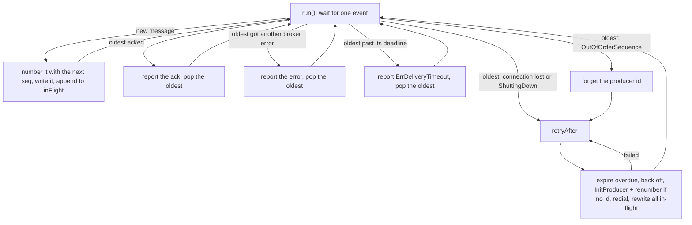
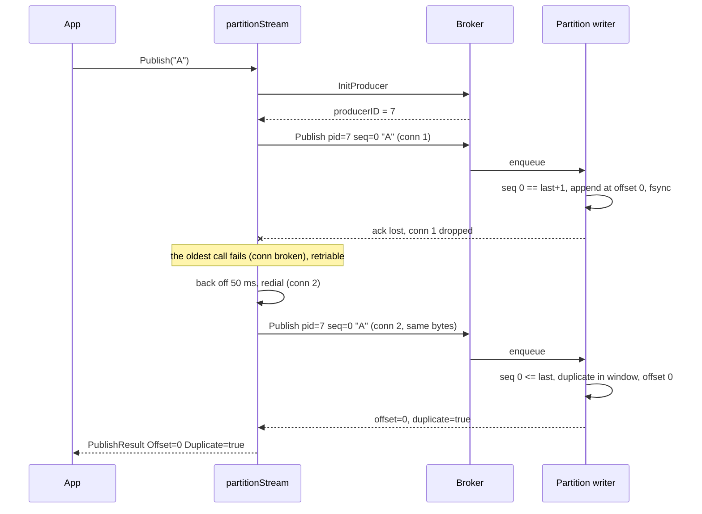

# Exactly-once publishing (the idempotent producer)

What this covers: how a message published through `client.Producer` lands in the log exactly
once even when connections drop, requests are retried, or the broker restarts. That's the broker's
dedup table, how it's persisted, and the client's per-partition sender that retries in order.
It ends with what an error from `Publish` means and the one known gap.

---

## 1. The idea in one paragraph

Retrying is the only way to survive a lost ack, and retrying causes duplicates. So every message
carries an identity the broker can recognise: **(producer id, sequence)**. The producer numbers
its messages per partition 0, 1, 2, … and the broker remembers the last sequence it wrote for each
producer id. A retry of something already written is re-acked instead of written again. A gap is
refused, so ordering can't silently break. Content hashes would reject legitimate identical
messages, and per-message idempotency keys are costly to store, which is why the design uses
sequences ([DESIGN.md](DESIGN.md#exactly-once-idempotent-producer)).

## 2. Producer ids

- Allocated by `InitProducer` → [`FileStore.NextProducerID`](../internal/metadata/filestore.go):
  a counter starting at 1, **persisted (atomic JSON rewrite + fsync) before it is returned**, so
  an id is never handed out twice, even across crashes.
- The broker does not check that an id was ever allocated; it just keys its table by it.
- In the client, **each partition stream gets its own producer id**. The first message on a
  (topic, partition) triggers an `InitProducer` ([`renumberUnderNewProducerID`](../client/stream.go)).
- `producerID = -1` (`record.NoProducerID`) opts out: no dedup at all (raw clients, tests).

## 3. Broker dedup rules

The partition's single writer goroutine checks every request **before** writing it
([`producerState.check`](../internal/partition/producerstate.go), called from
[`writer.handle`](../internal/partition/writer.go)). `last` is the newest sequence recorded for
that producer id, or `-1` for an unknown producer, so a new producer must start at 0.

| Incoming `seq` | Broker does | Response |
|---|---|---|
| `seq < 0` | rejects | `OutOfOrderSequence` ("negative sequence") |
| `seq == last + 1` | appends, records `(seq → offset)` | `offset`, `duplicate=false` |
| `seq <= last`, within the window | writes nothing | **original** `offset`, `duplicate=true` |
| `seq <= last`, older than the window | writes nothing | `offset = -1`, `duplicate=true` |
| `seq > last + 1` (gap) | rejects | `OutOfOrderSequence` |

### The 5-entry window

Per producer the broker keeps only the last **5** `(seq, offset)` pairs (`dedupWindow`). A retry
of any of those gets its real offset back; anything older is still recognised as a duplicate
(because `seq <= last`) but re-acked with offset `-1`. The client can have up to 256 messages in
flight per partition, so after a reconnect most re-acks may carry `-1`. **No message is written
twice either way**; only the offset is unknown. `PublishResult.Offset` can therefore be `-1`
when `Duplicate` is true.

### A duplicate is never acked before it's durable

In the default `-ack fsync` mode, if unflushed data exists, the original may be in it. So the
duplicate's ack joins the same pending batch and goes out after the next fsync
([`writer.ackDuplicate`](../internal/partition/writer.go)).

## 4. Persistence and expiry

The table must survive a crash, or a retry after restart would be written twice.

1. **Every write updates the table**, flushed or not (`producers.record` in `writer.write`).
2. **Checkpoint:** [`recovery.checkpoint`](../internal/partition/checkpoint.go) (JSON, written
   tmp + fsync + rename) holds the segment/position recovery may trust **and the producer table
   as of that point**. It is written right after a flush at most once per second
   (`CheckpointInterval`), on every segment roll, and on `Close`.
3. **Recovery** loads the checkpoint's table, then replays the headers of every record after the
   checkpoint position (each header holds `ProducerID` and `Sequence`), calling `record` for each
   ([`repairTail`](../internal/partition/recovery.go)). No checkpoint → scan the whole log from an
   empty table. Either way the table matches exactly the records that survived.
4. **Expiry:** before each checkpoint write, [`producerState.expire`](../internal/partition/producerstate.go)
   drops every producer whose newest record is below `LogStartOffset`. Retention deleted all its
   records (Kafka's rule). This keeps the table and checkpoint from growing forever. Such a
   producer is **new again**: its next sequence must be 0, so a client that keeps counting gets
   `OutOfOrderSequence` and must take a new id (§6 does this automatically).

Tests: `TestProducerStateSurvivesRestart`, `TestRestartKeepsState`, `TestRetentionExpiresProducers`.

## 5. Why routing is client-side

The sequence is per **(producer, partition)**. To stamp a sequence the producer must already
know the partition. If the broker picked the partition, the producer couldn't number messages
before sending them. So the client has a `Partitioner` ([producer.go](../client/producer.go)):

```go
type Partitioner interface {
    Partition(topic string, value []byte, numPartitions int) int32
}
```

The only built-in one is `SinglePartition{}` (always 0). The partition count comes from a
Metadata request, cached per topic; an unknown topic counts as 1 partition (the broker either
auto-creates it or rejects the publish).

## 6. The client's partition stream

Every (topic, partition) gets one [`partitionStream`](../client/stream.go): **one goroutine
(`run`) that owns** the producer id, the next sequence, the connection, and the in-flight queue
(max 256). Nothing in it is locked. `Publish` hands a message over through a channel and waits on
the message's own outcome channel.

Invariant: in-flight messages have **contiguous sequences under one producer id**, were written
**in order on one connection**, and are resolved **strictly oldest first**.



`retryAfter` / `send`, step by step:

1. Fail any in-flight messages past their delivery deadline (`expireOverdue`).
2. Sleep the backoff: `RetryBackoff` (default 50 ms), doubling per consecutive failure, capped at 1 s.
3. No producer id? Call `InitProducer` and **renumber every in-flight message from 0**.
4. Get a connection (the `redialer` dials a new one if the old one broke).
5. Rewrite **every** in-flight message, unchanged, in order. If the connection changed, older
   messages must go first, or the newest would arrive as a gap.
6. Any failure → repeat from 1.

### Key rules

| Rule | Why |
|---|---|
| **A caller that gives up stops waiting, not sending.** If `Publish`'s ctx ends, the message keeps its sequence and is still delivered in the background. | If a give-up removed a message, the broker would reject every younger one as a gap. |
| `DeliveryTimeout` (default 30 s, counted from `Publish`) bounds how long the stream keeps trying one message. Past it → `ErrDeliveryTimeout`. | Something has to end a message that can never be delivered. |
| A ctx **already done** when `Publish` is called sends nothing. A message whose caller gave up **before the stream numbered it** is dropped unsent (`partitionStream.add`). | Nothing was numbered, so nothing leaves a gap. |
| **The producer id resets only when the *oldest* in-flight message gets `OutOfOrderSequence`.** | Nothing older is outstanding, so the previous sequence is gone for good: an older message failed without being written, or the broker expired this producer. Waiting can't fix it. |
| `OutOfOrderSequence` on a younger message is never looked at while an older one is outstanding. | The stream only ever handles the oldest response, so it never retries a rejected sequence as is. |
| Other broker errors (e.g. `UnknownTopicOrPartition`, `MessageTooLarge`) → reported, popped. | The broker rejected it; retrying won't help. |

So **producer ids change only after a real failure**, never because a caller gave up.
`TestDeliveryTimeoutStartsNewProducerID` shows the reset: a lost message times out, the next one
hits the gap, and lands under a new id at sequence 0.

## 7. A retry after a dropped connection, end to end

The ack for `A` is lost when the connection dies. The resend is recognised and re-acked:
**one record**.



If instead the first copy never reached the broker, the resend is simply `seq == last + 1` and is
written once. Same for a broker restart: the dedup table is recovered from the checkpoint + log
tail before the writer starts, so the resend is still recognised (`TestProducerSurvivesBrokerRestart`).

## 8. "An error means maybe written"

| `Publish` returns | Was it written? |
|---|---|
| a result | yes, exactly once (`Duplicate` may be true, `Offset` may be `-1`) |
| ctx error, ctx was done **before** the call | no, nothing sent |
| ctx error, ctx ended **while waiting** | **maybe**: it is still being delivered in the background |
| `ErrDeliveryTimeout` | **maybe**: a copy may still land |
| `ErrClosed` (Producer closed while waiting) | **maybe** |
| broker rejection like `UnknownTopicOrPartition`, `MessageTooLarge`, `InvalidTopic` | no |

What this implies for you:

- **Don't re-publish by hand after an error.** The new call gets a new sequence, so if the first
  copy also lands you have two records. Same as Kafka.
- Exactly-once covers **producer → log**. If your app must never see a duplicate across its own
  retries, make the consumer idempotent (dedupe on a business key) or treat errors as "check, then
  decide".
- Ordering: messages from one goroutine land in call order (`TestChaosExactlyOnce` checks this).

## 9. Known gap: no producer epochs

Renumbering under a new id assumes **no copy of a failed message is still in transit** more than
`DeliveryTimeout` after it was sent. If one is (say, stuck in a buffer somewhere):

1. Message `M` (old id, seq 5) times out → `ErrDeliveryTimeout`.
2. The next message gets `OutOfOrderSequence`; the stream takes a new id and renumbers.
3. The stale copy of `M` lands later: old id, seq 5 == last + 1 → **accepted**.
4. Stale copies of the messages after it (old id, seq 6, 7, …) are accepted too, though they were
   already written under the new id → **duplicates**.

Kafka closes this with **producer epochs**: a new session bumps the epoch and the broker fences
writes from older epochs. Not implemented here.

## 10. How the chaos test proves it

[`TestChaosExactlyOnce`](../internal/server/chaos_test.go) runs a real broker behind a
[`faultProxy`](../internal/server/proxy_test.go):

- **16 goroutines × 150 publishes** share one `Producer` (one partition stream, heavy pipelining).
- The proxy adds 3 ms latency and **kills every connection every 20–60 ms**. Bytes it already
  read from the client still reach the broker **up to 30 ms later**, so the broker runs requests
  the client already considers lost. That's the "stale copy" race that a naive retry would turn
  into a duplicate.
- **10%** of calls give up after 0–7 ms (the caller-gives-up path). `RetryBackoff` is 2 ms.
- At the end it publishes `"last"`; since messages resolve strictly oldest first, every earlier
  one, abandoned ones included, is final by then.

It then reads the whole log and asserts:

| Check | Proves |
|---|---|
| no value appears twice | no duplicate, whatever the retries and late copies did |
| every acked value appears **exactly once**, at its acked offset (unless `-1`) | an ack is truthful |
| each goroutine's acked values are in call order | ordering survives reconnects |
| every record has the **same producer id** | giving up never forced a renumber; no message failed for good |

Related tests in [producer_test.go](../internal/server/producer_test.go):
`TestAbandonedPublishIsStillDelivered`, `TestDeliveryTimeoutStartsNewProducerID`,
`TestPublishWithDoneContextSendsNothing`, `TestProducerRetriesOnDeadConnection`; and in
[server_test.go](../internal/server/server_test.go): `TestIdempotentPublishOverWire`,
`TestProducerSurvivesBrokerRestart`.

---

## Where to look in the code

- [internal/partition/producerstate.go](../internal/partition/producerstate.go): `check`, `record`, `expire`, `dedupWindow`
- [internal/partition/writer.go](../internal/partition/writer.go): `handle`, `ackDuplicate`, `writeCheckpoint`
- [internal/partition/checkpoint.go](../internal/partition/checkpoint.go), [recovery.go](../internal/partition/recovery.go): `repairTail` replays producer sequences
- [internal/metadata/filestore.go](../internal/metadata/filestore.go): `NextProducerID`
- [client/producer.go](../client/producer.go): `Publish`, `Partitioner`, `isRetriable`, `backoff`
- [client/stream.go](../client/stream.go): `partitionStream.run`, `add`, `handleOldestResponse`, `retryAfter`, `send`, `renumberUnderNewProducerID`, `expireOverdue`
- [internal/server/chaos_test.go](../internal/server/chaos_test.go), [proxy_test.go](../internal/server/proxy_test.go), [producer_test.go](../internal/server/producer_test.go)
