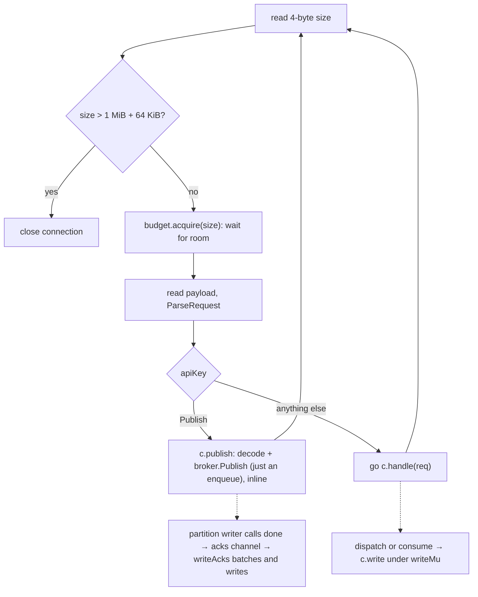
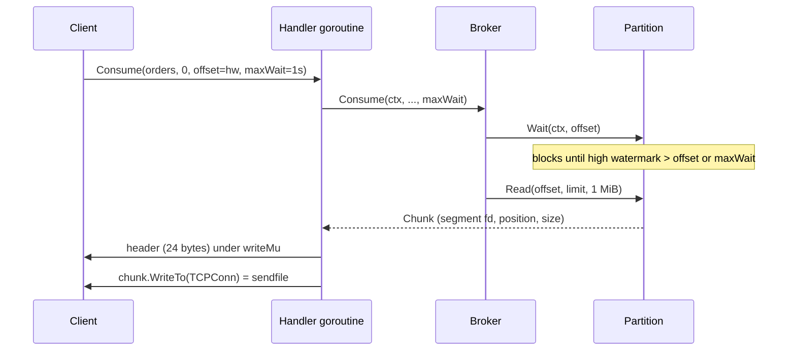

# Wire protocol

What this covers: the binary protocol clients speak to the broker over one long-lived TCP
connection: framing, field encodings, every API, error codes, pipelining, the zero-copy
consume response, and the limits the server enforces per connection.

---

## 1. Framing

Every message in both directions is a **frame**: a 4-byte big-endian size, then that many
bytes of payload. The size does not count itself.

```text
frame    = uint32 size | payload[size]

request  payload = uint16 apiKey | uint32 correlationID | body
response payload = uint32 correlationID | uint16 errorCode | string errorMessage | body
```

- The response **body is present only when `errorCode == 0`**. An error response that
  carries a body is rejected by the client as malformed ([`ParseResponse`](../internal/protocol/frame.go)).
- `errorMessage` is free diagnostic text (empty on success). The server cuts it at 65535 bytes.
- Every frame is written with **one `Write` call** ([`writeFrame`](../internal/protocol/frame.go)),
  so writers that serialize on a mutex never interleave half frames.

## 2. Primitive encodings

All integers are big-endian. Field order on the wire = field order in the Go struct
([messages.go](../internal/protocol/messages.go)).

| Type | Encoding |
|---|---|
| `int32` / `int64` | 4 / 8 bytes, two's complement |
| `bool` | 1 byte, `0` or `1` (any other value is malformed) |
| `string` | `uint16` length + bytes (max 65535) |
| `bytes` | `uint32` length + bytes |
| `[]T` | `int32` count + each item |

Decoding is defensive ([codec.go](../internal/protocol/codec.go), type `reader`):

- The first error is sticky; a decoder reads every field and checks once in `finish`.
- Lengths and counts are checked against the bytes actually left **before** allocating, so a
  bogus length can't trigger a huge allocation.
- Trailing bytes after the last field are an error (`ErrMalformed`).
- Encoding a string longer than 65535 bytes panics, so the client validates user input first
  ([`checkWireLen`](../client/errors.go)).

## 3. APIs

| Key | API | Request body | Response body |
|---|---|---|---|
| 1 | CreateTopic | `name string`, `partitions int32` | (empty) |
| 2 | Metadata | `topics []string` (empty = all) | `brokers []{id int32, addr string}`, `topics []{name string, partitions []{number int32, leaderID int32}}` |
| 3 | InitProducer | (empty) | `producerID int64` |
| 4 | Publish | `topic string`, `partition int32`, `producerID int64`, `sequence int64`, `value bytes` | `offset int64`, `duplicate bool` |
| 5 | Consume | `topic string`, `partition int32`, `offset int64`, `limit int32`, `maxWaitMs int32` | `highWatermark int64`, `records bytes` |
| 6 | Commit | `group string`, `topic string`, `partition int32`, `offset int64` | (empty) |
| 7 | GetCommittedOffset | `group string`, `topic string`, `partition int32` | `offset int64`, `found bool` |

Notes:

- **Metadata** leaves unknown topics out of the answer instead of failing.
- **Publish** carries the partition because routing is client-side (see
  [exactly-once.md](exactly-once.md)). `producerID = -1` (`record.NoProducerID`) skips dedup.
  `duplicate = true` means the broker already had this sequence; `offset` is then the original
  offset, or `-1` if it has fallen out of the broker's 5-entry window.
- **Consume** `records` are raw back-to-back records in the on-disk format (40-byte header +
  body, see [`record`](../internal/record/record.go)). The client decodes them with
  `record.DecodeAll`, which checks each CRC.

## 4. Example: one Publish request, byte by byte

`Publish{topic: "orders", partition: 0, producerID: 7, sequence: 0, value: "hello"}` with
correlation id 1. Payload = 43 bytes, frame = 47 bytes.

```text
00 00 00 2b                  size = 43
00 04                        apiKey = 4 (Publish)
00 00 00 01                  correlationID = 1
00 06 6f 72 64 65 72 73      topic: len 6, "orders"
00 00 00 00                  partition = 0
00 00 00 00 00 00 00 07      producerID = 7
00 00 00 00 00 00 00 00      sequence = 0
00 00 00 05 68 65 6c 6c 6f   value: len 5, "hello"
```

The ack (offset 0, not a duplicate), 21 bytes:

```text
00 00 00 11                  size = 17
00 00 00 01                  correlationID = 1
00 00                        errorCode = 0 (None)
00 00                        errorMessage: len 0
00 00 00 00 00 00 00 00      offset = 0
00                           duplicate = false
```

## 5. Error codes

Mapped from internal errors in [`errorCode`](../internal/server/handlers.go).

| Code | Name | Sent when |
|---|---|---|
| 0 | None | success |
| 1 | Unknown | anything unmapped; the server logs it. E.g. a partition taken offline by a disk error, a failed metadata write, a failed offsets store |
| 2 | UnknownTopicOrPartition | topic missing (and not auto-created) or no such partition number |
| 3 | OffsetOutOfRange | consume offset below the log start or above the high watermark; the message names the valid range |
| 4 | OutOfOrderSequence | sequence gap or negative sequence (see [exactly-once.md](exactly-once.md)) |
| 5 | MessageTooLarge | body over 1 MiB (`record.MaxBodySize`) |
| 6 | TopicExists | name already used, **ignoring case** |
| 7 | InvalidRequest | body doesn't decode, unknown API key, partition count outside 1..1024, group/topic too long for the offsets log |
| 8 | ShuttingDown | broker, partition or offsets store closed, or the connection is closing (`context.Canceled`) |
| 9 | InvalidTopic | name breaks `[a-zA-Z0-9._-]`, 1..200 chars, no `__` prefix |

On the client every code becomes a `*client.Error`, and `errors.Is(err, client.ErrTopicExists)`
etc. work via sentinel values ([errors.go](../client/errors.go)).

A request whose body is garbled still gets an `InvalidRequest` answer under its correlation id,
and the connection keeps working (`TestMalformedRequestKeepsConnection`). Only a frame too
short to hold a correlation id, or too large, closes the connection: there is nothing to answer.

## 6. Correlation IDs and pipelining

A client may send many requests without waiting. Responses can come back **in any order**;
the correlation id matches them up.

Client side ([conn.go](../client/conn.go)):

1. `register` takes the next id (starting at 1) and stores a `call` in `pending`.
2. `send` writes the frame under `writeMu` with a fixed 10 s write deadline. Not the caller's
   ctx: a timed-out write leaves half a frame and breaks the connection for everyone on it.
3. One `readLoop` goroutine reads frames and `deliver`s each to its `call` by id.
4. A caller whose ctx ends calls `forget`; a late response is dropped. A response that is
   already there wins over a ctx that ends at the same moment.
5. Any read/write error breaks the whole `Conn` (`fail`): every pending call fails, and the
   `Producer`/`Consumer` redial on next use ([redial.go](../client/redial.go)).

Server side ([conn.go](../internal/server/conn.go)): one goroutine per connection reads frames
in `readRequests` and dispatches them.



### Why Publish runs inline but everything else gets a goroutine

- **Publish inline:** the idempotent producer pipelines contiguous sequences on one connection.
  If two publishes ran in separate goroutines they could reach the partition queue swapped,
  and the broker would see `seq 5` before `seq 4` → `OutOfOrderSequence`. Handing Publish to the
  broker in the read loop makes **arrival order = append order**. It is cheap: `broker.Publish`
  only enqueues (it blocks only if the partition's 4096-slot queue is full, which then
  back-pressures this connection).
- **Others in goroutines:** Consume may long-poll for up to 30 s; Commit and InitProducer fsync.
  None of them must stall the read loop. Their order doesn't matter.

### The ack path never blocks the partition writer

The partition writer calls each publish's `done` callback after the group-commit fsync. That
callback only pushes into the connection's `acks` channel, sized to the 256 in-flight cap. Every
ack belongs to an unanswered request and the budget allows at most 256 of those, so the push never
blocks, even if the client stopped reading. One `writeAcks` goroutine drains whatever is queued
and writes it in **one** syscall: a group commit acks a whole batch at once
(`TestStalledReaderDoesNotBlockOthers`).

## 7. The Consume response: header, then sendfile

The broker never copies records into user space. [`consume.go`](../internal/server/consume.go):

1. `broker.Consume` long-polls if needed, then `partition.Read` returns a `Chunk`: a byte range
   of a segment file plus its **own open fd** (so retention deleting the file mid-send is safe).
2. [`ConsumeResponseHeader`](../internal/protocol/frame.go) builds the first 24 bytes, with the
   frame size already counting the records that will follow:

   ```text
   uint32 size | uint32 corrID | uint16 0 | uint16 0 (empty msg) | int64 highWatermark | uint32 recordsLen
   ```

3. `sendChunk` holds `writeMu`, writes the header, then `chunk.WriteTo(c.nc)`: an `io.Copy`
   from the file onto the raw `*net.TCPConn`, which Go turns into `sendfile(2)` on Linux.
4. Header + records is byte-for-byte what `WriteResponse` would produce for a
   `ConsumeResponse`, so the client decodes it normally (`TestConsumeResponseHeaderMatchesWriteResponse`).
5. If the send fails halfway, the frame is broken and the stream can't resync: the connection
   is closed.



A read returns at most `limit` records (`limit < 1` counts as 1), about 1 MiB of them, but always
at least one record if any is available, and never spans two segments. So a client loops until
it reaches the high watermark.

## 8. Server-side limits

All per [server.go](../internal/server/server.go), [conn.go](../internal/server/conn.go),
[consume.go](../internal/server/consume.go).

| Limit | Value | What happens at the limit |
|---|---|---|
| Max request frame | 1 MiB + 64 KiB (`maxRequestFrame`) | connection closed |
| Unanswered requests per connection | 256 (`maxInFlight`) | read loop stops reading; TCP flow control pushes back on the client |
| Unanswered request bytes per connection | 64 MiB (`MaxInFlightBytes`, raised to at least one max frame) | same: stop reading |
| Open connections | 1024 (`MaxConns`, flag `-max-conns`) | the extra connection is closed right after accept |
| Idle connection | 5 min (`IdleTimeout`, flag `-idle-timeout`) | connection closed; clients redial on next use |
| Long-poll wait | `maxWaitMs` clamped to 0..30 s (`maxConsumeWait`) | the poll returns empty |
| Consume response | ~1 MiB of records (`maxConsumeBytes` in broker) | fewer records returned |

How the budget works ([budget.go](../internal/server/budget.go)):

- The read loop reserves a frame's bytes **after reading the 4-byte size, before allocating the
  payload**. A client that pipelines faster than it's answered is held back by TCP, never
  buffered in broker memory.
- `release` happens when the response is written (`finish`). A 1-token channel wakes the single
  waiting reader, which re-checks the totals.
- The idle timer is a read deadline set before every read, so it measures "no bytes from the
  client", not "no responses".

---

## Where to look in the code

- [internal/protocol/protocol.go](../internal/protocol/protocol.go): API keys, error codes, `Body`
- [internal/protocol/frame.go](../internal/protocol/frame.go): `ReadFrame`, `WriteRequest`, `WriteResponse`, `ConsumeResponseHeader`, `ParseRequest/Response`
- [internal/protocol/codec.go](../internal/protocol/codec.go): primitive encoders, the sticky-error `reader`
- [internal/protocol/messages.go](../internal/protocol/messages.go): one struct per request/response body
- [internal/server/conn.go](../internal/server/conn.go): `readRequests`, `readFrame`, `publish`, `writeAcks`, `handle`
- [internal/server/consume.go](../internal/server/consume.go): `consume`, `sendChunk`
- [internal/server/budget.go](../internal/server/budget.go): `inFlightBudget`
- [internal/server/handlers.go](../internal/server/handlers.go): `dispatch`, `errorCode`
- [client/conn.go](../client/conn.go): `Conn`, `send`, `readLoop`, `call.wait`
- Tests: [protocol_test.go](../internal/protocol/protocol_test.go), [limits_test.go](../internal/server/limits_test.go), [server_test.go](../internal/server/server_test.go)
